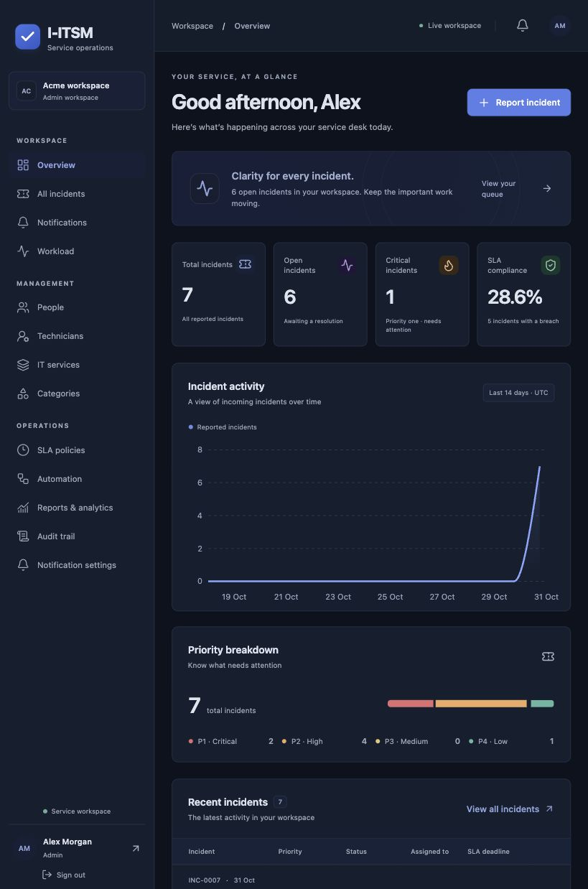

# I-ITSM

**Intelligent IT Service Management & Incident Resolution System**

A dark-themed React / Java / PostgreSQL course project for reporting, routing, investigating and resolving IT incidents. Employees, technicians and administrators use separate permissions and navigation. Every important mutation is persisted with an audit event and notifications.



## What works

- Employee registration and BCrypt/JWT sign-in; backend role and incident ownership checks.
- Incident reporting, service/category classification, explainable priority calculation and SLA deadlines.
- Automatic technician recommendation and assignment, manual overrides, capacity checks and availability constraints.
- The eight-state lifecycle: NEW → CLASSIFIED → ASSIGNED → ACKNOWLEDGED → IN_PROGRESS → RESOLVED → VERIFIED → CLOSED. Justified reopening returns to IN_PROGRESS.
- Investigation notes, information requests and employee replies, resolution verification, closure and feedback.
- Duplicate suggestions from real recent records, similarity scores and authorized confirm/reject review.
- Scheduled SLA warnings, persistent response/resolution violations and administrator escalations.
- Persistent in-app notifications and SMTP email with an administrator-visible delivery outbox.
- User/technician management, skills, availability, capacity, services/categories, SLA targets, strategy settings and priority thresholds.
- Combined search filters, pagination, reports, Recharts charts and per-technician workloads.
- Flyway migrations, database constraints, append-only audit enforcement, automated tests and eight editable/rendered UML diagrams.

## Technology

Java **21**, Spring Boot 3.5.7, Spring Web, Spring Security, Spring Data JPA/Hibernate, Maven, JWT (JJWT), Bean Validation, BCrypt, Flyway and PostgreSQL 17. Frontend: React 19, TypeScript, Vite, Tailwind CSS 4, React Router, Axios, Recharts and Lucide icons. Tests: JUnit 5, Mockito, Spring Boot Test, MockMvc, PostgreSQL repository tests, Vitest and React Testing Library.

The Maven compiler targets Java 21. The Docker backend uses Java 21. Dependencies are pinned through Maven and `package-lock.json` for reproducible builds.

## One-command native launch

With Java, Maven, Node and PostgreSQL command-line tools on PATH:

```bash
./scripts/start-local.sh
```

This creates local secrets if needed, starts the isolated PostgreSQL cluster, builds the backend, installs frontend dependencies if absent, and starts both servers with logs/PIDs in `.runtime`. Open http://127.0.0.1:5173. Run `python3 scripts/setup-env.py` to print your demo password. Stop using `./scripts/stop-local.sh --database`; data is preserved. Detailed foreground and Docker alternatives follow.

## Quick start — Docker

Prerequisites: Docker Engine / Docker Desktop with Compose, Python 3.

```bash
cd I-ITSM
python3 scripts/setup-env.py
docker compose up --build -d
```

Open **http://localhost:5173**. Backend: http://localhost:8080/api/health. PostgreSQL is bound to localhost:5432. The frontend proxies `/api` to the backend, including production client-side routing support.

`setup-env.py` creates random local secrets and prints demo credentials. Existing `.env` files are preserved. Never commit `.env`. Docker uses a named `postgres-data` volume; `docker compose down` preserves data. Do not use `down -v` if you want to keep the database.

Docker execution was not available in the authoring environment; native Java 21 + PostgreSQL verification is documented in `docs/verification.md`.

## Run natively — verified path

Prerequisites: JDK 21, Maven 3.9+, Node.js 24, npm, Python 3, PostgreSQL 17 command-line binaries (`initdb`, `pg_ctl`, `psql`, `createdb`). On macOS with Homebrew, make PostgreSQL's `bin` directory available on PATH. On Windows use Docker or run these shell scripts through a suitable Unix environment.

```bash
cd I-ITSM
python3 scripts/setup-env.py
./scripts/local-db.sh start
```

The script initializes an isolated database cluster in `.runtime/postgres`, bound to **127.0.0.1:55432**, and creates `iitsm` and `iitsm_test`. TCP connections use SCRAM authentication. Unix-socket access is intended for your own development machine. Data persists after stopping/restarting.

Terminal 1 — backend:

```bash
./scripts/run-backend.sh
```

Terminal 2 — frontend:

```bash
cd frontend
npm ci
npm run dev
```

Open http://127.0.0.1:5173. Vite proxies `/api` to port 8080. For another backend use `API_PROXY_TARGET`; for a separately deployed frontend set `VITE_API_BASE_URL` during its build and configure the exact frontend origin in `CORS_ORIGINS`.

Stop the isolated database with `./scripts/local-db.sh stop`. Stop foreground application processes using Ctrl+C. For the already prepared workspace, `.env` contains its generated credentials and the database is populated; setup does not overwrite either.

## Environment

| Variable | Meaning |
| --- | --- |
| `DB_URL` | JDBC PostgreSQL URL; native default uses port 55432, Compose overrides to `db:5432` |
| `DB_USER`, `DB_PASSWORD` | PostgreSQL credentials |
| `JWT_SECRET` | Random signing key of at least 32 characters; no default secret |
| `CORS_ORIGINS` | Comma-separated exact allowed frontend origins |
| `DEMO_ENABLED` | Explicitly opt into demo seeding (default false) |
| `DEMO_PASSWORD` | Initial password for demo accounts; minimum 10 characters |
| `PORT` | Backend port, default 8080 |
| `SLA_INTERVAL_MS` | Scheduler delay, default 30000 milliseconds |
| `TEST_DB_URL`, `TEST_DB_USER`, `TEST_DB_PASSWORD` | Separate PostgreSQL test database configuration |

All sensitive values are supplied through the environment. JWTs expire after eight hours. Deactivating an account immediately blocks its existing tokens because the JWT filter checks the database on each request. Browser tokens live in sessionStorage and are cleared on sign-out/401.

## Demo accounts

Run `python3 scripts/setup-env.py` to print the password from your local `.env`.

| Role | Email |
| --- | --- |
| Employee — Jordan Lee | `employee@iitsm.local` |
| Technician — Priya Sharma | `technician@iitsm.local` |
| Administrator — Alex Morgan | `admin@iitsm.local` |
| Additional employee | `sam@iitsm.local` |
| Additional technician | `marcus@iitsm.local` |

All seeded accounts use `DEMO_PASSWORD`. Demo seeding runs only when explicitly enabled and the users table is empty. Six sample incidents are real persisted records created through domain priority/assignment/event operations, not frontend fixtures. Changing DEMO_PASSWORD after users exist does not reset passwords. Seed administration is not enabled in production by default.

## Demonstration walkthrough

1. Sign in as the employee and report an incident with service, category, description, impact, urgency and affected users. Inspect its computed priority reason, deadlines and technician.
2. Sign in as its assigned technician. Acknowledge, start investigation, request information, add a note, then record a resolution of at least ten characters.
3. Return as the reporter. Verify the fix, close the incident and submit feedback. Reopen only with a reason of at least ten characters.
4. Report a similar incident on the same service/category. As an administrator or assigned technician, review the related-incident suggestion and its similarity score.
5. As administrator, manage a technician's skills/availability/capacity, switch assignment strategy, change thresholds or SLA targets, inspect reports, audit history and the email outbox.
6. For SLA demonstration, set the relevant response target to one minute before reporting a fresh incident. Wait past its response deadline and the next monitoring interval. Inspect the persisted breach and administrator escalation. Existing incident deadlines are not rewritten by a policy edit.

## Architecture and project structure

```text
I-ITSM/
├── frontend/
│   ├── src/
│   │   ├── components/       # shared controls, table, route guard
│   │   ├── context/          # authentication and toast state
│   │   ├── hooks/            # API request state
│   │   ├── layouts/          # role-aware application shell
│   │   ├── pages/            # public, incidents, management and accounts
│   │   ├── services/         # Axios transport
│   │   ├── types/            # API models
│   │   └── utils/            # display formatting
│   ├── package-lock.json
│   └── Dockerfile
├── backend/
│   ├── src/main/java/com/iitsm/
│   │   ├── controller/ dto/ mapper/
│   │   ├── service/ entity/ model/ repository/
│   │   ├── strategy/ state/ observer/ factory/
│   │   └── security/ exception/ config/ scheduler/
│   ├── src/main/resources/db/migration/
│   ├── src/test/java/com/iitsm/
│   ├── pom.xml
│   └── Dockerfile
├── docs/
│   ├── uml/                 # eight .puml sources and eight .svg renders
│   ├── screenshots/
│   ├── requirements.md architecture.md database-design.md
│   ├── design-patterns.md oop-concepts.md test-cases.md
│   ├── technology-justification.md api.md verification.md
├── database/sample-data.sql
├── scripts/
├── docker-compose.yml
└── .env.example
```

Controllers validate transport data and delegate to services. Services enforce ownership, transactions and business rules. Domain entities encapsulate mutation. Strategies select algorithms through dependency injection; states validate transitions; observers append audit/notification effects within the same transaction. Spring Data implements repository interfaces. The UI consumes DTOs and never receives password hashes.

See [architecture](docs/architecture.md), [database design](docs/database-design.md), [API reference](docs/api.md), [OOP mapping](docs/oop-concepts.md), [design patterns](docs/design-patterns.md), and the [requirements checklist](docs/requirements.md).

## Testing

Use a dedicated test database. Tests never use H2 or a mocked database in place of PostgreSQL.

```bash
./scripts/local-db.sh start
./scripts/test-backend.sh
cd frontend
npm ci
npm test
npm run build
```

For Docker's database, create `iitsm_test` and set `TEST_DB_URL=jdbc:postgresql://localhost:5432/iitsm_test`. Unit tests can be run independently with `mvn test -Dtest='PriorityStrategyTest,AssignmentStrategyTest,IncidentStateTest,DuplicateDetectionTest,SlaTrackingTest,EventPublisherTest'`.

Backend integration tests cover real JWT login, ownership, lifecycle, duplicate review, scheduled SLA logic, notification privacy, administrative configuration and PostgreSQL persistence. Frontend tests cover login, password/form validation, protected routes, dashboard data, incident submission and filtering. See [test cases](docs/test-cases.md) and [verification results](docs/verification.md).

## OOP and design patterns

Encapsulation: private entity fields and controlled methods. Abstraction/polymorphism: priority, assignment, state, observer and channel interfaces. Inheritance: User → Employee / Technician / Administrator, and the shared state validator. Composition: Incident owns embedded SlaTracking. Association/aggregation: reporters, technicians, reusable skills, services and immutable history. Collections: skill sets, typed strategy maps, event lists and state successor sets. Exceptions: typed domain failures and centralized HTTP mapping.

Implemented patterns: **Strategy**, **State**, **Observer**, **Factory**, **Repository**, with constructor dependency injection. Each is mapped to real source classes in the documentation.

## Editable UML deliverables

Every source has an SVG with the same basename in `docs/uml/`:

1. `use-case-diagram.puml` / `use-case-diagram.svg`
2. `class-diagram.puml` / `class-diagram.svg`
3. `sequence-diagram-incident-reporting.puml` / `sequence-diagram-incident-reporting.svg`
4. `sequence-diagram-technician-assignment.puml` / `sequence-diagram-technician-assignment.svg`
5. `activity-diagram-incident-lifecycle.puml` / `activity-diagram-incident-lifecycle.svg`
6. `component-diagram.puml` / `component-diagram.svg`
7. `deployment-diagram.puml` / `deployment-diagram.svg`
8. `database-er-diagram.puml` / `database-er-diagram.svg`

The updated [class atlas](docs/uml/class-atlas/I-ITSM-Complete-UML.pdf) contains 12 detailed diagrams covering all 139 declared Java types. Open the [complete class map](docs/uml/class-atlas/00-complete-project.svg), [incident and user detail](docs/uml/class-diagram.svg), or [strategy detail](docs/uml/class-atlas/03-strategies.svg). Editable sources, SVG/PNG renders and a type-to-source index are included in `docs/uml/class-atlas/`.

Render using an official PlantUML JAR and Graphviz (`dot` on PATH): `PLANTUML_JAR=/absolute/path/plantuml.jar ./scripts/render-uml.sh`. Supporting diagrams use Smetana; the detailed class diagrams use Graphviz. The render script includes both the eight primary diagrams and all thirteen class-atlas sources. The database ER reflects the Flyway schema, including single-table users, the technician-skills join and embedded SLA columns.

## Known limits and deployment considerations

This is a tested, self-contained course demonstration application. It has not undergone a production penetration test, load test, accessibility audit, or an operations review. Docker configuration is included but Docker was unavailable for execution here.

In-app notifications are polled. SLA targets use elapsed wall-clock minutes and include weekends. Reopened incidents retain original deadlines and historical breach flags.

Reports and the SLA scan read scoped incident records in memory; larger deployments should use aggregate queries, scheduled batches and indexed deadline scanning. Duplicate detection compares recent (30-day) incident token sets and is explainable, not an LLM or trained semantic model. One scheduler instance is assumed; clustered deployment needs distributed scheduling/idempotency. Audit triggers protect routine application access, not a database superuser who can alter schema.

Before external deployment configure HTTPS, secret management, backups/recovery, rate limiting, token revocation policy, observability, mail delivery, least-privilege database credentials, retention and capacity testing. Future enhancements: attachments, knowledge-base suggestions, enterprise SSO, business calendars, live events, semantic matching and exportable reports.

### SMTP email delivery

Set `SMTP_HOST`, `SMTP_USERNAME`, and `SMTP_PASSWORD` in the local `.env` and restart the backend. The default port is 587 with authentication and required STARTTLS. `SMTP_FROM` defaults to the SMTP username. For Gmail, use `smtp.gmail.com` and a [Google App Password](https://support.google.com/accounts/answer/185833) for the sender account. Keep the credential in the environment or a secret store. An I-ITSM login password is separate from SMTP credentials.

The assigned technician receives a message with the deadlines for each assignment. Each outstanding response and resolution clock triggers reminders at 50% and 90% elapsed. The scheduler checks thresholds on its normal polling interval and deduplicates by incident, technician, deadline and milestone. The incident reporter receives an email on each state change, including resolution details when resolved and a separate closure email.

The administrator can enable or disable email generation under **Notification settings** and monitor the outbox. With no SMTP host configured, messages stay pending. A worker sends committed messages via SMTP, retries unsuccessful delivery, and marks accepted messages **Sent**. Past-due reminders expire instead of being sent. Seeded `.local` addresses are skipped, and historical simulated records retain their original status.

### Email recipient overrides

Set `EMAIL_RECIPIENT_OVERRIDES` to comma-separated `source=destination` pairs to redirect future outgoing email while preserving login addresses, account ownership, and in-app notifications. For example, `technician@iitsm.local=shared-support@example.com,marcus@iitsm.local=shared-support@example.com`. Restart the backend after changing this setting. Previously queued or skipped messages are not rewritten or replayed.
